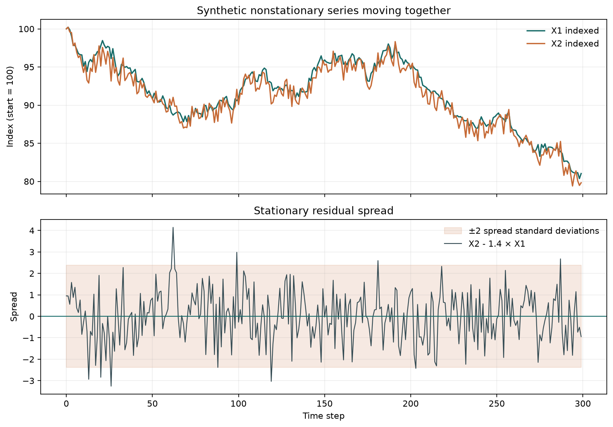

# Crypto Cointegration Monitor

A small Python project for testing crypto price pairs for cointegration and monitoring a rolling spread. Market candles and ticker prices are fetched from the public Bitfinex API.

> **Paper trading only:** `main.py` does not submit exchange orders. Its P/L is an estimate from price changes and does not include fees, slippage, or funding.

## Cointegration Example

The chart below is generated from synthetic data. The example defines `X2 = 1.4 × X1 + ε`, where `X1` is a random walk and `ε` is stationary noise. The series are nonstationary individually, while their linear combination is stationary.



## Setup

From the project folder in PowerShell, create and activate a virtual environment and install the dependencies:

```powershell
python -m venv .venv
.\.venv\Scripts\Activate.ps1
python -m pip install --upgrade pip
python -m pip install requests pandas pyfinance statsmodels
```


## Run

Run the pair scan first:

```powershell
python .\coint.py
```

It downloads historical 30-minute candles for Bitfinex markets quoted in BTC and prints an Engle-Granger cointegration statistic, p-value, and critical values for each ordered pair. The script waits three seconds between candle requests, so a large scan can take a while.

Run the rolling spread monitor with:

```powershell
python .\main.py
```

By default, it monitors `tLTCBTC` and `tSOLBTC`, fetches 14 days of 30-minute candles, and refreshes every 30 minutes. It prints the latest Z-score and ticker prices. A Z-score above `2` opens a paper short-spread position; below `-2` opens a paper long-spread position. If a paper position is open, it prints unrealized P/L. Press `Ctrl+C` to stop the loop.

The default pair is an example, not a confirmed cointegrated pair. `main.py` does not require a significant result from `coint.py` before opening a paper position. In a previous scan, LTC/SOL had a p-value near `0.056`, which did not pass the usual 5% threshold. Select and validate pairs before relying on the monitor.

## Formulas

For the two price series `X1` and `X2`, the monitor estimates a rolling hedge ratio `β` by regressing `X2` on `X1` over 20 observations. It then calculates:

```text
spread[t] = X2[t] - β[t] × X1[t]
z_score[t] = (spread[t] - rolling_mean_40[t]) / rolling_std_40[t]
```

The cointegration test in `coint.py` uses the Engle-Granger test. Its null hypothesis is that the series are not cointegrated. A p-value below a chosen significance level (commonly `0.05`) is evidence against that null; a larger p-value means the test did not find sufficient evidence. The critical values are reported at 1%, 5%, and 10% levels.
